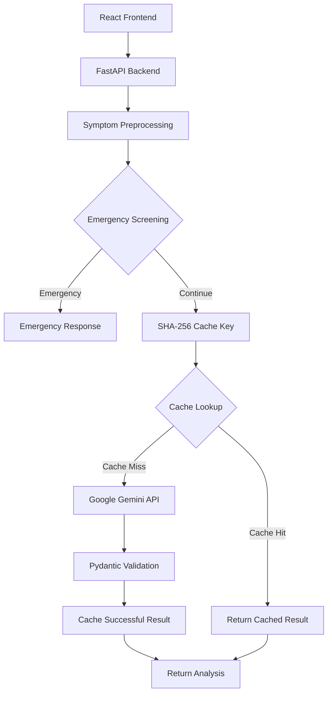

 <div align="center">

# HealthAI

### Understand symptoms. Explore possibilities. Make informed next steps.

An AI-powered symptom analysis application built with **React, FastAPI and Google Gemini.**

<br/>


<br/>

**[Features](#-what-it-does) · [Architecture](#-under-the-hood) · [Tech Stack](#-technology-stack) · [Setup](#-getting-started) · [Testing](#-testing)**

</div>

---

## 01. The Project

HealthAI started with a simple idea: explore how Large Language Models can be used to make preliminary health information more accessible.

Users describe their symptoms, provide additional context such as duration and severity, and receive AI-generated insights containing possible conditions, explanations and recommended next steps.

But the interesting part isn't just the Gemini integration. It's how the application processes, validates and handles those responses before presenting them to the user.

## 02. What It Does

| Feature | Implementation |
|:--|:--|
| Symptom Analysis | Context-aware analysis using Gemini |
| Input Preprocessing | Normalization of user-reported symptoms |
| Emergency Screening | Checks for predefined emergency indicators before LLM processing |
| Intelligent Caching | SHA-256 based request keys to reuse previous results |
| Structured Responses | Pydantic schema validation |
| Error Handling | Handles invalid inputs and service failures |

## 03. Under the Hood

The application follows a simple request-processing pipeline.



**A few engineering decisions worth highlighting:**

- Emergency screening happens before the Gemini API call.
- Cache keys are generated using normalized symptoms, duration and severity.
- Repeated requests can reuse cached responses instead of making unnecessary API calls.
- Gemini responses are validated against a defined Pydantic schema before being returned.

## 04. Technology Stack

| Layer | Technology |
|:--|:--|
| Frontend | React.js, Vite |
| Backend | Python, FastAPI |
| AI Integration | Google Gemini API |
| Data Validation | Pydantic |
| Caching | Python cache service, SHA-256 |
| Testing | Pytest |
| Version Control | Git, GitHub |

## 05. Project Structure

```text
HealthAI/
│
├── backend/
│   ├── app/
│   │   ├── core/
│   │   ├── routes/
│   │   ├── schemas/
│   │   ├── services/
│   │   └── main.py
│   │
│   ├── tests/
│   │   └── test_symptom_api.py
│   │
│   ├── .env.example
│   └── requirements.txt
│
├── frontend/
│   ├── public/
│   ├── src/
│   └── package.json
│
└── README.md
```

## 06. Getting Started

### Prerequisites

- Python 3.10+
- Node.js and npm
- Google Gemini API key

### Backend

```bash
cd backend

python -m venv venv
venv\Scripts\activate

pip install -r requirements.txt
```

Create a `.env` file inside `backend/`:

```env
GEMINI_API_KEY=your_api_key
GEMINI_MODEL=gemini-3.5-flash
```

Start the backend:

```bash
uvicorn app.main:app --reload
```

API documentation: `http://127.0.0.1:8000/docs`

### Frontend

Open a separate terminal:

```bash
cd frontend
npm install
npm run dev
```

Open the local URL provided by Vite.

## 07. API Reference

**POST** `/api/v1/analyze`

Example request:

```json
{
  "symptoms": "Burning sensation in my stomach",
  "duration": "1-3 days",
  "severity": "Moderate"
}
```

The API returns structured information containing:

- Possible health conditions
- Explanations
- Matching symptoms
- Recommended next steps
- Medical disclaimer

The response also identifies whether the result came from the cache or Gemini.

## 08. Testing

Testing is performed using Pytest and FastAPI's test client.

```bash
python -m pytest tests/ -v
```

**Latest test results**

| Test Case | Result |
|:--|:--:|
| Empty symptom validation | PASS |
| Short symptom validation | PASS |
| Successful symptom analysis | PASS |
| Emergency screening bypass | PASS |
| Symptom result caching | PASS |

<div align="center">

### 5 / 5 TESTS PASSED

</div>

## 09. What's Next?

This project is still evolving. My current focus is on making the system more reliable and closer to a production-ready application.

- Evaluating the grounding and consistency of LLM-generated responses.
- Improving input validation and error handling.
- Exploring deployment and monitoring.
- Strengthening automated testing.

---

## A Note on Medical Safety

HealthAI is an experimental application that provides preliminary AI-generated health information. It does not diagnose medical conditions, prescribe treatments or replace professional medical evaluation. Emergency symptoms require appropriate immediate medical attention.

---

<div align="center">

**HEALTHAI**

*Built to explore the intersection of AI and accessible health information.*

</div>
